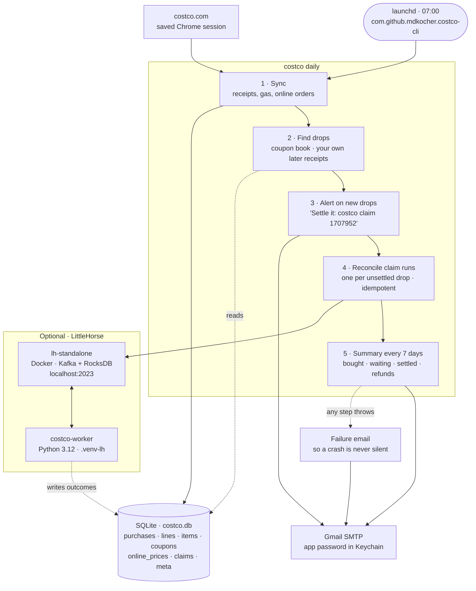
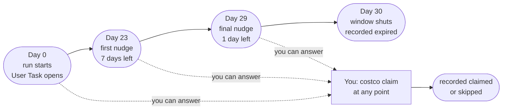

# Architecture

A local CLI that syncs your Costco receipts, spots items that got cheaper, and holds a
durable 30-day reminder for each one. SQLite is the record; the workflow engine is optional.

## 07:00 every morning

One launchd job runs the whole pipeline. Each step reads or writes the same SQLite file;
only two steps reach outside the machine.



Without LittleHorse the first three steps are unchanged, step 4 logs `claim tracking idle`,
and `costco claim` still records outcomes. You lose the reminders, nothing else.

## What happens to one claimable drop

A run begins the first morning the drop exists, and lasts until you answer it or the
window shuts. The timers live on the server, so they survive restarts, reboots, and a
worker that goes away.



An `expired` never overwrites an answer you already gave. Claiming at the counter from a
machine that cannot reach the server is the normal case, not the edge case.

## Who holds what

| Store | Holds | If it is lost |
|---|---|---|
| `costco.db` | Purchases, line items, coupons, observed prices, claim outcomes, settings | The real loss. Everything else can be rebuilt or recreated. |
| Keychain `costco-cli-email` | The Gmail app password | Alerts fall back to macOS notifications. Re-run `costco notify email`. |
| `chrome-profile/` | Your signed-in Costco session | Sync stops and emails you. `costco login` needs a human at the screen. |
| Docker volume `lh-data` | Open claim runs, their timers, pending User Tasks | Survivable. Tomorrow's reconcile recreates a run for every unsettled drop. |

## What breaks, and what happens

| Failure | Effect |
|---|---|
| LittleHorse server down | The job logs `claim tracking idle`, finishes everything else, retries tomorrow. Run ids derive from the purchase line, so nothing starts twice. |
| Worker down | Nudges and outcomes queue on the server and execute when a worker reappears. Reminders arrive late rather than never. |
| Mail fails | The alert still shows as a macOS notification with the reason attached, then the error raises. |
| Costco sign-in expired | Sync stops and mails you. The one failure that genuinely needs a human at the Mac. |
| Nothing runs at all | Silence between one weekly summary and the next means something is wrong. That is what the summary is for. |

## Running the optional half

The LittleHorse SDK supports Python 3.10–3.13, while the CLI itself runs on anything from
3.10 up — so the worker gets its own interpreter and the CLI never imports the SDK.

```bash
python3.12 -m venv .venv-lh && ./.venv-lh/bin/pip install -e '.[littlehorse]'

docker run --name lh-standalone -d -v lh-data:/data -e KAFKA_DATA_DIR=/data/kafka \
  -p 2023:2023 -p 8080:8080 -p 9092:9092 \
  ghcr.io/littlehorse-enterprises/littlehorse/lh-standalone:1.3.1

./.venv-lh/bin/costco-worker
```

`KAFKA_DATA_DIR` is not optional. The image's entrypoint sets `KAFKA_LOG_DIR` but tests
`KAFKA_DATA_DIR`, so without it Kafka is reformatted with a new cluster id on every boot
and a persistent volume makes the second start fail outright.

The dashboard at `localhost:8080` is an ops console, not a task inbox — it can show a
pending User Task but offers no way to complete one. That is what `costco claim` is for.

## The rule that isn't obvious

`git push` does not change what runs at 07:00. The scheduled job calls the pipx copy, so a
change only reaches it after:

```bash
pipx install --force /Users/mkocher/dev-zone/costco-cli
```
