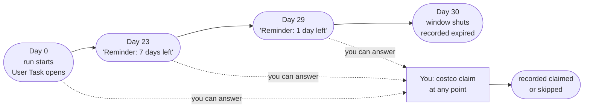

# Architecture

A local CLI that syncs your Costco receipts, spots items that got cheaper, and holds a
durable 30-day reminder for each one. SQLite is the record of truth; LittleHorse runs the
waiting.

## 07:00 every morning

One launchd job runs the whole pipeline. Each step reads or writes the same SQLite file;
only two steps reach outside the machine.


LittleHorse is a required component: `littlehorse-client` is a core dependency and the CLI
pins to Python 3.10–3.13 because of it. A server that is *unreachable* is a different thing
from an absent one — it is a fault, reported and emailed, but it does not undo the receipt
sync that already succeeded above. Those are unrelated concerns and failing one on the other
would cost you purchase data for no reason.

## What happens to one claimable drop

A run begins the first morning the drop exists, and lasts until you answer it or the
window shuts. The timers live on the server, so they survive restarts, reboots, and a
worker that goes away.



An `expired` never overwrites an answer you already gave. Claiming at the counter from a
machine that cannot reach the server is the normal case, not the edge case.

## Who holds what

| Store | Holds | If it is lost |
|---|---|---|
| `costco.db` | Purchases, line items, coupons, observed prices, claim outcomes, settings | The real loss. Everything else can be rebuilt or recreated. |
| Keychain `costco-cli-email` | The Gmail app password | Alerts fall back to macOS notifications. Re-run `costco notify email`. |
| `chrome-profile/` | Your signed-in Costco session | Sync stops and emails you. `costco login` needs a human at the screen. |
| Docker volume `lh-data` | Open claim runs, their timers, pending User Tasks | Survivable. Tomorrow's reconcile recreates a run for every unsettled drop. |

## What breaks, and what happens

| Failure | Effect |
|---|---|
| LittleHorse server down | Reported as `claim tracking DOWN` and emailed. Sync and drop detection still complete; the reconcile retries tomorrow. Run ids derive from the purchase line, so nothing starts twice. |
| Worker down | Nudges and outcomes queue on the server and execute when a worker reappears. Reminders arrive late rather than never. |
| Mail fails | The alert still shows as a macOS notification with the reason attached, then the error raises. |
| Costco sign-in expired | Sync stops and mails you. The one failure that genuinely needs a human at the Mac. |
| Nothing runs at all | Silence between one weekly summary and the next means something is wrong. That is what the summary is for. |

## Running the workflow half

One interpreter, one venv: the SDK ships with the CLI.

```bash
costco server start    # pinned image, persistent volume, the right env vars
costco worker install  # LaunchAgent: restarts itself, waits when the server is down
```

Both wrap what used to be copy-pasted. `costco server` and `costco worker`
report state; bare `costco` shows both alongside the money waiting.

`costco server start` passes `KAFKA_DATA_DIR` for you, which matters more than it
looks: the image's entrypoint sets `KAFKA_LOG_DIR` but tests `KAFKA_DATA_DIR`, so
without it Kafka is reformatted with a new cluster id on every boot and a persistent
volume makes the second start fail outright. A flag you never type is a flag you
cannot forget.

The dashboard at `localhost:8080` is an ops console, not a task inbox — it can show a
pending User Task but offers no way to complete one. That is what `costco claim` is for.

## The rule that isn't obvious

`git push` does not change what runs at 07:00. The scheduled job calls the pipx copy, so a
change only reaches it after:

```bash
pipx install --force /Users/mkocher/dev-zone/costco-cli
```
